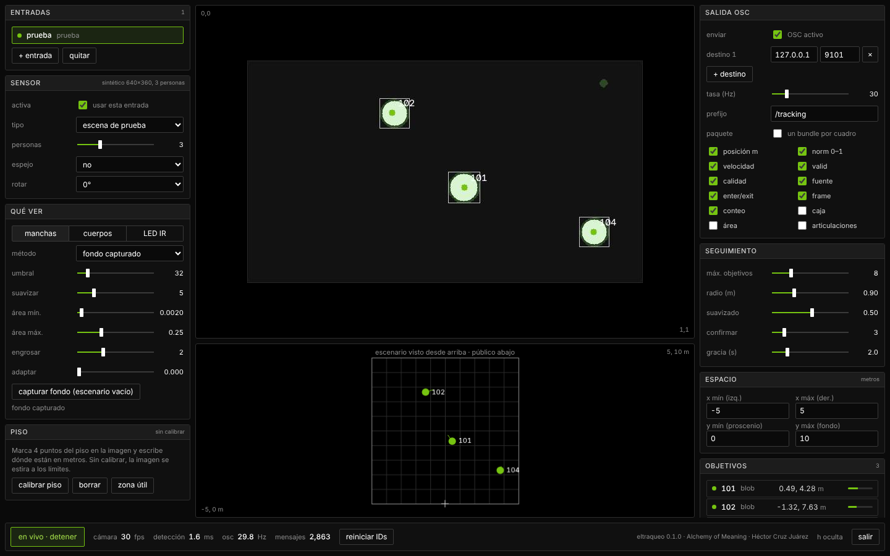
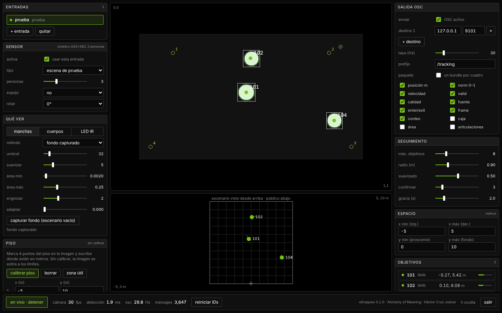
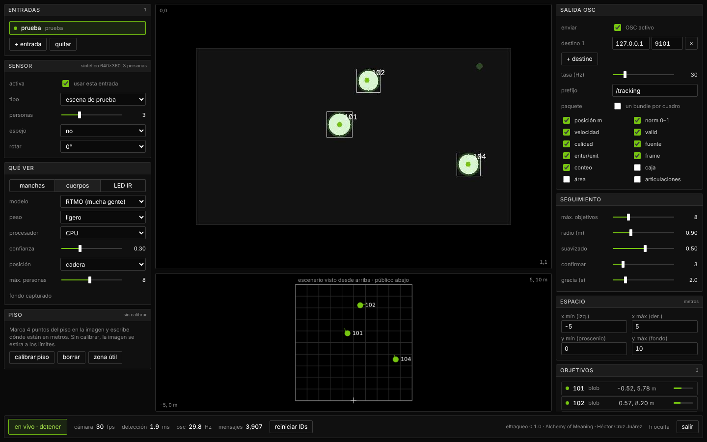
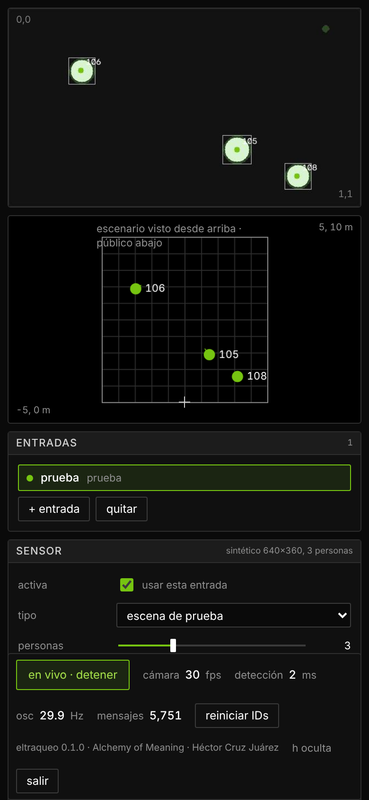

# eltraqueo



*Versión 0.1.0*

Tracking escénico por cámara con salida OSC, para Isadora, TouchDesigner, PIXERA, Millumin o cualquier software que escuche OSC. App de escritorio para Mac y Windows: se abre, eliges las cámaras y qué detectar (manchas, cuerpos, LED IR), y empieza a mandar datos.

Parte de la colección **Alchemy of Meaning (Alquimia del Significado)**. Licencia GPL-3.0-or-later.

**English below.**

---

## Qué detecta

| Modo | Para qué | Notas |
|------|----------|-------|
| **manchas** | personas u objetos vistos desde el techo (cenital) | Resta de fondo y centros de masa. Lo más estable y barato. Con escenario vacío, pulsa *capturar fondo*. |
| **cuerpos** | personas de frente o de lado | Esqueleto de 17 puntos con RTMO o RTMPose (rtmlib, ONNX). Desde el techo no sirve; para cenital usa manchas. La primera vez descarga el modelo, así que hace falta internet. |
| **LED IR** | puntos brillantes; más adelante, identidad por parpadeo | Preparado para la vía de identidad física (tags 1–99). |
| **LiDAR** | LD19 / LD06 por puerto serie | Experimental, sin probar en sala. |

Varias entradas a la vez: cada cámara (o LiDAR) es una entrada. Si calibras el piso en todas, las detecciones que caen en el mismo lugar se unen en un solo objetivo.

## Uso

1. Abre eltraqueo. La interfaz se abre en el navegador (`http://127.0.0.1:8765`).
2. **Entradas:** elige la cámara, la resolución y el espejo o rotación.
3. **Qué ver:** manchas, cuerpos o LED IR.
4. **Piso:** *calibrar piso*. Toca 4 puntos marcados en el piso y escribe sus coordenadas en metros. Sin calibrar, la imagen se estira a los límites del escenario.
5. **Salida OSC:** destinos `host:puerto` (puede haber varios) y qué mensajes mandar.
6. `espacio` inicia o detiene, `h` oculta la interfaz y *salir* cierra la app.

Para manejarlo desde el teléfono, abre con `--lan` y entra a la dirección que aparece en la consola. No tiene contraseña: úsalo solo en redes de confianza.

```
eltraqueo [--lan] [--port 8765] [--osc 192.168.1.20:9100] [--synthetic] [--idle] [--config ruta.json]
```

`--synthetic` abre una escena de prueba (manchas que caminan), para probar la recepción OSC sin cámara.

La configuración se guarda sola en `~/.eltraqueo/config.json`.

## OSC

UDP, puerto por omisión **9100**, prefijo `/tracking`. Solo enteros y flotantes.

| Dirección | Argumentos | |
|-----------|------------|--|
| `/tracking/frame` | `i seq, f t, i n` | al inicio de cada envío |
| `/tracking/count` | `i n` | objetivos activos |
| `/tracking/{id}/position` | `f x, f y` | metros |
| `/tracking/{id}/norm` | `f u, f v` | 0–1 dentro de los límites |
| `/tracking/{id}/velocity` | `f vx, f vy` | m/s |
| `/tracking/{id}/valid` | `i 0/1` | 0 = sin dato reciente (la posición se congela) |
| `/tracking/{id}/quality` | `f 0–1` | |
| `/tracking/{id}/source` | `i` | 1 cámara · 2 UWB · 3 fusión · 4 LiDAR |
| `/tracking/{id}/enter` · `/exit` | `i 1` | una vez |
| `/tracking/{id}/bbox` | `f u0 v0 u1 v1` | opcional, en la imagen |
| `/tracking/{id}/area` | `f` | opcional |
| `/tracking/{id}/joints` | 51 × `f` | opcional: 17 × (u, v, confianza) en la imagen |
| `/tracking/system/hz` · `/status` | `f` · `i` | cada segundo |

**IDs:** 1–99 = identidad física (LED IR o UWB, futuro); 101–199 = objetivos sin identidad. La tasa de salida es fija (30 Hz por omisión): con más de 0.25 s sin datos el objetivo pasa a `valid 0`, y tras la gracia (2 s) se manda `exit`.

**Isadora:** OSC Listener con el puerto 9100; en *Stream Setup*, detecta `/tracking/101/norm` y saca u y v.
**TouchDesigner:** OSC In CHOP en el puerto 9100; cada canal llega como `tracking/101/norm1`, `tracking/101/norm2`.

## Arquitectura

Las capas están separadas para que un sensor nuevo solo agregue las capas 1 y 2:

```
1 sensores/    cámara · video · prueba · lidar (LD19)          → Frame
2 detectores/  manchas · pose · leds · lidar_clusters          → Observation
3 localizers/  una vista + homografía de piso · (triangulación, fase 2) → Candidate (m)
4 tracker.py   IDs, suavizado, velocidad, fusión entre entradas, tags
5 osc_out.py   OSC/UDP
```

Para sumar un sensor (UWB, otra cámara IR): subclase de `Sensor` en `eltraqueo/sensors/`, registrarlo en `REGISTRY` y, si da imagen, usar un detector existente. Si da metros, que el detector devuelva observaciones `kind="floor"`.

## Desde el código

```bash
python -m venv .venv && source .venv/bin/activate   # en Windows: .venv\Scripts\activate
pip install -r requirements.txt
python run_eltraqueo.py
python -m pytest tests
```

**GPU para cuerpos:** en Windows con Nvidia, `pip install onnxruntime-gpu` (necesita CUDA y cuDNN) y elige *GPU Nvidia* en la interfaz. En Mac, prueba *Apple (CoreML)*. Si no carga, usa CPU: RTMO ligero va bien en CPU.

## Compilar

Cada sistema se compila en sí mismo: `pyinstaller eltraqueo.spec --noconfirm`. El flujo de GitHub Actions (`.github/workflows/build.yml`) compila los dos al empujar una etiqueta `v*` y los publica en Releases.

**Mac:** la app no está firmada. La primera vez ábrela con clic derecho → Abrir y acepta el permiso de cámara.

## Hoja de ruta

- **v0.1** — una o varias cámaras, manchas, cuerpos, LED IR (detección), homografía de piso, OSC, interfaz local.
- **v0.2** — triangulación 3D con ChArUco (`localizers/triangulate.py`), salida MIDI de respaldo en 14 bits.
- **v0.3** — identidad por LED IR con parpadeo; pruebas del LiDAR LD19 en sala.
- **después** — fusión con UWB (los IDs 1–99 ya están reservados).

## Capturas / Screenshots

| | | |
|---|---|---|
|  |  |  |
| Principal: vista de cámara, mapa del escenario y salida OSC · *Main view: camera, stage map and OSC output* | Calibración del piso con 4 puntos · *Floor calibration with 4 points* | Ajustes de cuerpos (pose) · *Body (pose) settings* |
|  | | |
| Control desde el teléfono (`--lan`) · *Phone control (`--lan`)* | | |

---

## English

**eltraqueo** is a desktop app for Mac and Windows for camera-based stage tracking, with OSC output to Isadora, TouchDesigner, PIXERA, Millumin or anything that listens to OSC. Open it, pick your cameras and what to detect, and it starts sending data.

- **Blobs:** background subtraction and centroids. The best choice for an overhead camera; press *capture background* with an empty stage.
- **Bodies:** a 17-joint skeleton from RTMO or RTMPose (rtmlib, ONNX), for front or side cameras. The model downloads on first use, so that first run needs internet.
- **IR LED:** bright-point detection, ready for physical identity by blink code (IDs 1–99).
- **LiDAR:** LD19 / LD06 over serial. Experimental.

Calibrate the floor by clicking 4 marked points and typing their positions in metres. Several cameras calibrated to the same floor are merged into one target per person. The OSC spec is in the table above: `/tracking/{id}/position`, `norm`, `velocity`, `valid`, `quality`, `source`, `enter`, `exit`, plus optional `bbox`, `area` and `joints`. Default port is 9100 and the rate is fixed at 30 Hz.

Run from source with `pip install -r requirements.txt` and `python run_eltraqueo.py`. Builds for both systems come from GitHub Actions when a `v*` tag is pushed. The Mac app is unsigned: right-click → Open the first time.

## Créditos / Credits

Diseño, investigación y desarrollo: Héctor Cruz Juárez — https://hectorcruz.com.mx  
Colección Alchemy of Meaning.

Licencia / License: GPL-3.0-or-later (ver / see `LICENSE`).
